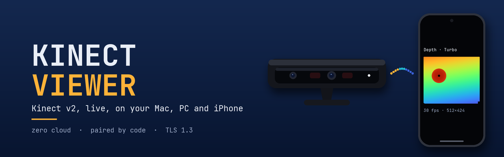
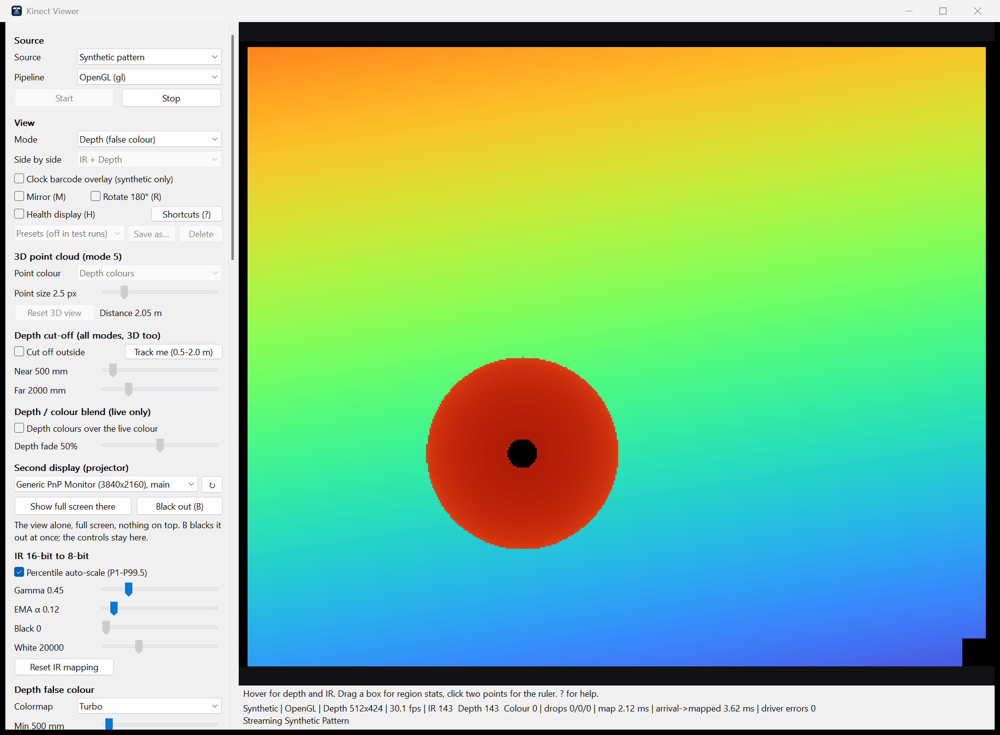

<div align="center">



<br><br>

A live viewer for the Microsoft Kinect v2 on a Mac or a Windows PC, streamed to an iPhone over
pinned TLS 1.3. Depth, infrared and colour, with no cloud in between.

<br>


[**Features**](#features) · [**Hardware**](#supported-hardware) · [**Setup**](#setup) · [**Pairing**](#pairing) · [**Commands**](#commands) · [Under the hood](#under-the-hood) · [Status](#status) · [Troubleshooting](TROUBLESHOOTING.md)

</div>

<br>

The Kinect's frames stay on the computer it is plugged into. Paired devices get an encoded H.264
picture over mutual TLS 1.3; raw depth, IR and colour frames, point clouds and body-tracking joints
never leave the host. Recordings are 16-bit depth or IR, written only on the host and deleted
after 7 days. Colour is live only and never written to disk, with one exception: the Windows pet
camera's camera roll, off by default, keeps its clips on that PC and plays them, with their JPEG
thumbnails, to its paired devices. The iPhone app writes nothing to disk; its pairing lives in the Keychain. There is no cloud
service, no sign-in and no relay.

## Features

### On the Mac

- **Five views.** IR, Colour, Depth in false colour, Side by Side (IR + Depth, Colour + Depth,
  Colour + IR), and a 3D point cloud drawn with Metal that you orbit, pan and zoom.
- **No silent fallback.** Pick libfreenect2's OpenGL, OpenCL or CPU depth pipeline. If it fails to
  start, streaming stops and the error is shown.
- **Controls for each stream.** IR: percentile auto-scale, gamma, smoothing. Depth: Turbo, Viridis,
  Inferno or Grayscale with Desk, Spec and Room presets, invalid and saturated pixels black. Colour:
  auto, flicker-free semi-auto or manual exposure, read back from the sensor. Ranges are below.
- **Measuring.** Hover for depth in mm and raw IR, drag a box for region statistics, click two
  points for a 3D ruler from the sensor's own IR intrinsics. **Space** freezes the frame in memory.
- **Cut-off and blend.** Near and far planes that black out everything else (**Track me** sets
  0.5–2.0 m), and depth colours faded over the registered live colour.
- **Body and hand skeleton** from Apple Vision, run on the Mac and drawn over Depth, IR and 3D.
  Nothing is stored.
- **Second display.** Any view full screen on a projector or second screen; **B** blacks it out.
- **Depth and IR recording,** 16-bit and lossless: FFV1 `.mkv` through FFmpeg, or a 16-bit PNG
  sequence, each with a timestamps CSV. A reminder comes before recording, a library replays
  sessions through the live pipeline, and each is deleted after 7 days. They go only to
  `~/kinect-viewer-recordings/` (`0700`), excluded from iCloud (`.nosync`), Time Machine and
  Spotlight. An iPhone can start or stop one; none is ever sent to it.
- **Colour is live only.** Colour and Side by Side frames stay in memory: no recordings, snapshots,
  thumbnails or caches. In those modes **Start Recording** is off, with *Colour is live only. Switch
  to IR or Depth to record.* The one exception is the Windows pet camera's **camera roll** (off by
  default): clips kept on that PC and played to its paired devices; see
  [docs/pet-camera.md](docs/pet-camera.md).
- **Watch a Camera.** It also watches a Windows pet camera and plays its camera roll, in memory.
- **Presets, a health display (H)** with fps, drops, timing, driver errors and the USB port, and the
  last-used settings restored at launch.
- **Shares the sensor.** If another process holds `~/KINECT-IN-USE`, the host waits without
  touching USB. While it has the Kinect it writes its name, PID and start time there, and deletes
  the file on stop, unplug, sleep or exit.

### On Windows

- **The same viewer** in Win32 and Direct3D 11: every view including 3D, the IR, depth and exposure
  controls, measuring, cut-off, blend, presets, the second display, the health display, recordings
  and the `KINECT-IN-USE` lock (in `%USERPROFILE%`). Recordings go to
  `%USERPROFILE%\kinect-viewer-recordings\`, owner-only, skipped by Windows Search and never inside
  OneDrive.
- **A pet camera.** Up to 16 paired devices, each an **owner** or a **viewer**, with up to 4
  watching and 8 connected at once. A **Watching now** banner over the view names everyone watching,
  and can't be hidden.
- **Privacy mode,** one button: all live video and playback stop at once, to every device, owners
  included. It is kept across restarts.
- **Sharing,** off by default, with a schedule of times when viewers can't watch. Sharing and its
  schedule apply to viewers; owners watch at home either way.
- **A camera roll** (off by default): H.264 clips and JPEG thumbnails kept on that PC, started by
  hand, by motion seen in depth (lamps and daylight don't trip it) or on a schedule. By default
  clips are kept 30 days and up to 200 GB, starred ones are never deleted automatically, and
  recording stops below 20 GB free. Devices stream clips to play them, never download them.
- **Viewing from outside the home** (off by default, turned on at the PC only): a second listener
  and a UPnP port mapping, straight from that PC with no relay, plus one-time invites. It can't work
  behind carrier-grade NAT, and the panel says so.
- **Stays reachable.** While outside viewing is on, the PC is kept from sleeping and a watchdog
  starts the viewer again after a crash.
- **`kinect-cli`:** a presence check, a benchmark, a headless streaming host, a synthetic recorder
  and a read-only router probe.
- **A per-user install** with no admin rights: `install.ps1` copies the build and its licence texts
  and adds a Start menu shortcut, and `uninstall.ps1` removes exactly that.

### On the iPhone

- **The live view, in memory only.** Video decodes straight into an `AVSampleBufferDisplayLayer`
  with `preventsCapture` on, the URL cache is 0 bytes, and the picture is cleared when the app
  leaves the foreground, during screen recording or mirroring, and on a screenshot.
- **Remote controls,** when the host allows them: the Kinect on and off, the view mode, cut-off and
  Track me, freeze, and a host recording after its reminder. In 3D, drag, pinch and two-finger pan
  move the host's camera.
- **Pairing** by QR code or 8-digit code, and the Windows host's invite and address links.
- **With a Windows host:** live quality (Auto, High, Medium, Low), who is watching, privacy mode and
  sharing for owners, and the camera roll: browse by day, play, star, and delete for owners.

### Connection and security

- **Mutual TLS 1.3, pinned both ways.** Each side has its own self-signed ECDSA P-256 certificate
  and accepts only the SHA-256 of the other's full leaf certificate, compared in constant time. No
  certificate authority is trusted.
- **Pairing needs someone at the host.** A pairing window (`_kv2p._tcp`) opens only from the host,
  for 120 seconds and one attempt. The QR code carries a 256-bit one-time token and the host's
  fingerprint, so a QR pairing is pinned from the first byte; the proof is HKDF-SHA256 and
  HMAC-SHA256 bound to both certificates. A wrong 8-digit code closes the window. On Windows the
  host, never the device, chooses the device's role.
- **Silent while unpaired.** With nothing paired and no pairing window open, a host advertises
  nothing over Bonjour. Once paired it advertises only a random 12-hex-digit `_kv2s._tcp` name whose
  TXT record carries no identity.
- **Keys stay put.** The iPhone and the Mac keep theirs in the Keychain (on the iPhone,
  `kSecAttrAccessibleWhenUnlockedThisDeviceOnly`). Windows wraps its key with DPAPI in an owner-only
  folder.
- **Fails closed** (Windows). Settings that can't be read keep privacy mode on, a device list that
  can't be read admits no device, and both refuse changes until they can be read; an identity that
  can't be used means no serving, never a quiet new identity.
- **Honest limits.** The Mac host is less hardened than the Windows host, and the 8-digit code is
  weaker than the QR code. [SECURITY.md](SECURITY.md) says exactly how.

<details>
<summary><b>Every setting, with its range</b></summary>

| Setting | Range and notes |
|---|---|
| IR | 512×424, 16-bit time-of-flight amplitude mapped to 8 bits; streamed 2× nearest-upscaled at 1024×848 |
| Colour | 1920×1080 via TurboJPEG; about 30 fps in bright light, 15 fps in low indoor light |
| Depth | 512×424 in mm, streamed at 1024×848; invalid (≤ 0, NaN, Inf) and saturated-IR (65535) pixels black |
| Side by Side | IR + Depth 1024×424, Colour + Depth 1280×424, Colour + IR 1280×424; colour runs apart, so 15 fps colour never slows the 30 fps depth/IR half |
| 3D point cloud | Rendered on the host at 960×720; only that picture is sent |
| Depth pipeline | OpenGL (default), OpenCL (Mac), CPU |
| IR auto-scale | P1–P99.5 of non-zero, unsaturated pixels, per frame |
| Gamma | 0.20–1.40, default 0.45 |
| Smoothing (EMA α) | Default 0.12; 1.00 is unsmoothed |
| Black / White | A fixed 16-bit window when auto-scale is off |
| Colour map | Turbo (default), Viridis, Inferno, Grayscale; near is warm or bright |
| Distance | 300–8000 mm; Desk 0.4–2.5 m, Spec 0.5–4.5 m (the sensor's specified range), Room 0.5–8 m |
| Exposure | Auto with −2.0 to +2.0 EV; semi-auto (flicker-free, with auto gain) 4.0–66.0 ms; manual shutter 1.0–66.0 ms and analogue gain 1.0–4.0× |
| White balance | Not offered: libfreenect2's public API has no call for it, only raw codes its header doesn't document |
| Cut-off | Near 200–5000 mm, Far 400–8000 mm |
| Recording | FFV1 16-bit lossless `.mkv` (`ffmpeg -nostdin`, bit-exact on read-back) or a 16-bit PNG sequence, with `<mode>_timestamps.csv` (`frame_index, engine_seq, device_ticks, arrival_mach_ns`); the write rate in MB/min is shown |
| Allow iPhone Remote Controls (Mac) | On by default. Off locks the iPhone to the mode chosen on the Mac and turns its remote controls off |

</details>

<!-- The screenshot row, held back until the four images are in docs/screens/ (each with its own .gitignore line):
<p align="center">
  
  &nbsp;
  
  &nbsp;
  
  &nbsp;
  
</p>
-->

## Supported hardware

| What | Needs | Tried on |
|---|---|---|
| **Kinect v2** | The sensor (USB ID `045e:02c4`, "Xbox NUI Sensor") with its adapter, which gives it power and a USB 3.0 cable, on a USB 3 port | One sensor, firmware 4.0.3917.0 |
| **Mac host** | Apple Silicon, macOS 26 or later, Xcode 26 or later | An M1 Pro MacBook Pro, macOS 26.5, Xcode 26.5 |
| **Windows host** | Windows 11 x64, a USB 3 port (best: a rear port wired to the CPU, with no hub), Visual Studio 2026 Build Tools | One Windows 11 PC, where depth and IR dropped about half their frames ([Status](#status)) |
| **iPhone** | iOS 26 or later, and an Apple developer team to sign the app | The iOS 26.5 Simulator (iPhone 17 Pro); built and signed for a device |

Kinect Viewer is built from source. There are no prebuilt downloads.

---

## Setup

| | Step | Time |
|:-:|---|---|
| **1** | [Build the host](#1-build-the-host) | Mac: about 15 min. Windows: an hour or more the first time (OpenSSL builds from source) |
| **2** | [Connect the Kinect](#2-connect-the-kinect) | About 5 min |
| **3** | [Install the iPhone app](#3-install-the-iphone-app) | About 10 min |
| **4** | [Pair](#pairing) | 1 min |

### 1. Build the host

<details open>
<summary><b>Mac</b></summary>

Install [Homebrew](https://brew.sh), then the tools and libfreenect2's dependencies:

```sh
brew install cmake pkgconf libusb jpeg-turbo glfw xcodegen ffmpeg
```

Build libfreenect2 0.2.0 at the pinned commit (there's no Homebrew formula for it). From the
checkout's folder (`vendor/` is git-ignored):

```sh
git clone https://github.com/OpenKinect/libfreenect2.git vendor/libfreenect2-src
git -C vendor/libfreenect2-src checkout fd64c5d9b214df6f6a55b4419357e51083f15d93
cmake -S vendor/libfreenect2-src -B vendor/libfreenect2-build -DCMAKE_BUILD_TYPE=Release \
  -DCMAKE_POLICY_VERSION_MINIMUM=3.5 -DENABLE_CXX11=ON -DENABLE_CUDA=OFF \
  -DCMAKE_INSTALL_PREFIX="$HOME/libfreenect2"
cmake --build vendor/libfreenect2-build --target install
```

CMake should find OpenGL, OpenCL, VideoToolbox and TurboJPEG. To install it somewhere other than
`~/libfreenect2`, set `LIBFREENECT2_PREFIX` in `Config/Local.xcconfig` (copy
`Config/Local.xcconfig.example`).

Then build the app and the command-line tool (`xcodegen generate` first only if `project.yml`
changed):

```sh
xcodebuild -project KinectViewer.xcodeproj -scheme KinectHostApp \
  -destination 'platform=macOS,arch=arm64' -configuration Release \
  -derivedDataPath build/DerivedData build
xcodebuild -project KinectViewer.xcodeproj -scheme kinect-cli \
  -destination 'platform=macOS,arch=arm64' -configuration Release \
  -derivedDataPath build/DerivedData build
open build/DerivedData/Build/Products/Release/KinectViewer.app --args --synthetic
```

The host runs FFmpeg from `/opt/homebrew/bin` or `/usr/local/bin` for FFV1 recordings; without it,
recordings are 16-bit PNG sequences.

</details>

<details>
<summary><b>Windows</b></summary>

Everything goes in one folder that also holds the checkout (`C:\src` here): `build.cmd` looks for
libfreenect2 and vcpkg beside it. [docs/windows-setup.md](docs/windows-setup.md) has the versions,
sizes and the variables that move each folder.

1. **Tools:** Visual Studio 18 2026 Build Tools with the C++ workload, then CMake 4.x, Ninja and Git
   on `PATH`: `winget install --id Kitware.CMake`, `--id Ninja-build.Ninja`, `--id Git.Git`.
2. **This repository** in `C:\src\kinect-viewer`.
3. **libfreenect2's dependencies,** as prebuilt x64 releases under `C:\src\deps`: libusb 1.0.30 in
   `deps\libusb`, libjpeg-turbo 3.2.1 (Visual C++ x64) in `deps\turbojpeg`, GLFW 3.5.1 (64-bit) in
   `deps\glfw`.
4. **libfreenect2** at commit `fd64c5d9`, with the OpenGL and CPU pipelines and no OpenCL or CUDA,
   installed to `C:\src\libfreenect2\install`. The configure line, which names each dependency, is
   in [docs/windows-setup.md](docs/windows-setup.md#prerequisites). Its `bin\` then holds the four
   DLLs the build copies next to each program.
5. **vcpkg,** at the baseline `windows\vcpkg.json` names:

   ```bat
   cd /d C:\src
   git clone https://github.com/microsoft/vcpkg.git vcpkg
   git -C vcpkg checkout b58529e33332fbb6dfe20317a82009b78ceeab36
   vcpkg\bootstrap-vcpkg.bat -disableMetrics
   ```

6. **FFmpeg,** for recording: `winget install --id Gyan.FFmpeg --scope user` (or set `KV_FFMPEG` to
   `ffmpeg.exe`'s full path).
7. **Build:**

   ```bat
   cd /d C:\src\kinect-viewer
   windows\scripts\build.cmd
   build\windows\windows\kinect-viewer.exe --synthetic
   ```

   The first build installs OpenSSL and the QR code generator through vcpkg.
   `build.cmd test` also runs the tests ([CONTRIBUTING.md](CONTRIBUTING.md)).
8. *Optional:* install it for your user, with a Start menu shortcut (`-Desktop` adds a desktop one;
   uninstall it from Settings › Apps):

   ```bat
   powershell -NoProfile -ExecutionPolicy Bypass -File windows\packaging\install.ps1 -From build\windows\windows
   ```

The first run that listens on the network raises a Windows Firewall prompt. Allow it on **Private**
networks, and make sure your Wi-Fi or Ethernet profile is Private, or the iPhone can't find or reach
the host.

</details>

> [!TIP]
> **You should see:** the window with its controls and the synthetic test pattern streaming at about
> 30 fps. On the Mac, the toolbar switches between **This Mac's Kinect** and **Watch a Camera**. On
> Windows, `build\windows\windows\` holds `kinect-viewer.exe`, `kinect-cli.exe` and four DLLs beside
> them.

### 2. Connect the Kinect

Plug the adapter into the mains and its USB cable into a USB 3 port.

<details open>
<summary><b>Mac</b></summary>

```sh
build/DerivedData/Build/Products/Release/kinect-cli --duration 10
```

</details>

<details>
<summary><b>Windows</b></summary>

1. Swap the Kinect's driver to **libusbK** with [Zadig](https://zadig.akeo.ie) (see [libfreenect2's
   instructions](https://github.com/OpenKinect/libfreenect2)). Never UsbDk, which is reported to
   stop Windows 11 24H2 and later from booting.
2. Check it, then run the 60-second benchmark:

   ```bat
   set CLI=build\windows\windows\kinect-cli.exe
   %CLI% list
   %CLI% bench --pipeline gl
   ```

</details>

> [!TIP]
> **You should see:** on the Mac, `KINECT_LOCK_ACQUIRED=true`, a summary with
> `source=real_kinect_v2`, `avg_fps` close to 30 and `driver_errors=0`, then
> `KINECT_LOCK_RELEASED=true`. On Windows, `kinect_usb_present=yes` and `libfreenect2_devices=1`,
> then `BENCHMARK=PASS`. A `FAIL` with sequence drops is usually the USB port: see
> [TROUBLESHOOTING.md](TROUBLESHOOTING.md).

Then start the app without `--synthetic`: it opens the Kinect with the OpenGL pipeline at once.

### 3. Install the iPhone app

1. Copy `Config/Local.xcconfig.example` to `Config/Local.xcconfig` (it's git-ignored) and set your
   team (`KV_DEVELOPMENT_TEAM`) and bundle-ID prefix (`KV_BUNDLE_ID_PREFIX`). Without it the apps
   build as `com.example.kinectviewer.*` with no team, for the Simulator only.
2. `open KinectViewer.xcodeproj`, choose the **KinectPocketViewer** scheme and the iPhone (over USB
   or Wi-Fi) as the destination, and press **Cmd+R**. A paid Apple Developer team's certificate
   lasts up to a year; free provisioning lasts 7 days. If iOS asks, turn on **Developer Mode** in
   Settings › Privacy & Security.
3. On first launch, allow **Local Network** (to find and reach the host) and, if you scan the QR
   code, **Camera**. The 8-digit code works without it.

> [!TIP]
> **You should see:** **Kinect Viewer** on the home screen, opening on **Not Paired with a Camera**
> with a **Pair Camera** button.

### Pairing

Pairing is once per device. The host shows a one-time code for 120 seconds; the device proves it saw
that code, and from then on each side accepts only the other's pinned certificate.

#### A. With the Mac host

1. **On the Mac**, click **Pair iPhone…** in the **iPhone Live Stream (mTLS 1.3)** panel. A sheet
   shows a QR code and an 8-digit code (`XXXX-XXXX`), with its countdown.
2. **On the iPhone**, tap **Pair Camera**, then either scan the QR code, or type the 8-digit code,
   confirm **This is my own home Wi-Fi**, and tap **Pair**.

The Mac pairs one iPhone at a time: pairing another replaces it, and **Unpair** on either side
removes the pin.

#### B. With the Windows host

1. **On the PC**, in the **Pet camera** panel, choose **Pair a device…** and pick **Viewer (watch
   only)** or **Owner**. The window shows a QR code; **Use a code instead** adds the 8-digit code.
2. **On the iPhone**, scan the QR code (or type the code, as above). **On a Mac**, choose **Watch a
   Camera**, then type the code or paste a `kv2://pair` link.

Each pairing adds a device. **Devices…** renames them, changes roles, re-pairs a phone that lost its
identity, and revokes one or all.

> [!TIP]
> **You should see:** the live view on the device. The Mac's panel says **Streaming Encrypted to
> iPhone**; the PC shows **Watching now:** with the device's name over its view.

Prefer the QR code: the 8-digit code doesn't pin the host's certificate, so it is safe only on a
network you trust. After pairing, the device reconnects by itself on the home network. To watch a
Windows host from outside the home, turn on **Share the camera** and **Allow viewing from outside
the home** on the PC, then make an **Invite from outside…** (10 minutes, one use) and send it
through a private channel, only to the person you're inviting: see
[docs/pet-camera.md](docs/pet-camera.md).

---

## Commands

### `kinect-cli` on Windows

In `build\windows\windows\`. `kinect-cli --help` lists the options.

| Command | What it does |
|---|---|
| `kinect-cli list` | Is a Kinect on the bus (SetupDi), is the lock free, how many devices libfreenect2 sees. Exit 3: the lock is held; 5: on the bus but not visible to libfreenect2 |
| `kinect-cli bench --pipeline gl` | 60 s benchmark. `PASS` (exit 0) needs depth/IR at 29 fps or more, no sequence drops and no driver errors; `FAIL` exits 4, a held lock 3, no Kinect on the bus 5. `--json PATH` saves it |
| `kinect-cli run --synthetic --duration 5 --verify-barcode` | Stream for a while and print the stats; on the synthetic source, decode the clock barcode in every frame |
| `kinect-cli run --mode color --test-exposure` | Apply auto, semi-auto and manual exposure and print the sensor's readback |
| `kinect-cli verify-lock` | The lock guard's self-test, with a temporary lock file; no device opened |
| `kinect-cli verify-no-fallback` | Ask for the OpenCL pipeline (not in this build) and check it fails without trying another. Needs the Kinect (otherwise `SKIPPED`) |
| `kinect-cli serve --pair --pair-role owner` | A headless streaming host on the Kinect, with a 120 s pairing window; prints the QR link (QR only; `--pair-code` takes the code too) |
| `kinect-cli serve --synthetic --clock-overlay --pair` | The same on the synthetic source, with its state in a temporary folder unless `--state-dir DIR` |
| `kinect-cli record --synthetic --mode ir` | 16-bit FFV1 `.mkv` of the synthetic source (`--png16` for PNG, `--out DIR`). Colour and the real sensor are refused: record the Kinect in the viewer |
| `kinect-cli router-probe --outside-port N` | Read-only: how this PC's router would judge a new public address. Every address it prints is masked |

The serial number is hidden unless `--show-serial` is given.

### `kinect-cli` on the Mac

In `build/DerivedData/Build/Products/Release/`. It takes flags only, has no `--help`, and ignores
flags it doesn't know.

| Command | What it does |
|---|---|
| `kinect-cli [--synthetic] [--mode ir\|depth\|color\|sbs] [--pipeline gl\|cl\|cpu] [--duration S]` | Stream (the Kinect unless `--synthetic`, IR for 5 s by default) and print the summary. Exit 3: the lock is held |
| `kinect-cli --synthetic --verify-barcode` | Decode the clock barcode in every frame |
| `kinect-cli --mode color --test-exposure` | Apply each exposure mode and print the sensor's readback |
| `kinect-cli --verify-lock` / `--verify-no-fallback` | The lock guard and no-fallback self-tests (they use a test lock under `./tmp`) |
| `kinect-cli --test-stream-latency [--synthetic]` | Pair a loopback client and measure sensor-to-display latency over pinned TLS 1.3 |
| `kinect-cli --test-recording` | Synthetic only: record into a temporary folder and check it bit for bit |
| `kinect-cli --test-hardening [--synthetic]` | Unpaired silence, the pairing burn, pinning against a second phone and reconnects; without `--synthetic`, also a stop and reopen of the real sensor |
| `kinect-cli --serve-simulator-test FILE` | Serve the synthetic source and write the pairing QR link to `FILE`, for the iOS Simulator |

The summary includes the sensor's serial number: remove it before pasting the output anywhere.

### Launch options

| Program | Options |
|---|---|
| `KinectViewer.app` (after `open … --args`) | `--synthetic` (the test pattern instead of the Kinect), `--clock-overlay` (a millisecond stopwatch and 64-bit barcode, synthetic only), `--no-autostart` (wait for **Start**) |
| `kinect-viewer.exe` | `--synthetic`, `--no-autostart`, `--pipeline gl\|cpu`, `--mode ir\|depth\|color\|sbs\|3d`, `--sbs-layout`, `--colormap`, `--clock-overlay`, `--show-health`, `--track-me`, `--blend PERCENT`, `--point-color depth\|ir\|rgb`, `--point-size PX`, `--state-dir DIR` |

A `--synthetic` launch of the Windows viewer keeps its state in a temporary folder, never the real
one, and reads no presets.

## Under the hood

- **A portable C++20 core** (`core/`) behind a C ABI (`core/include/kinect_core_c.h`): the
  libfreenect2 and synthetic sources, the IR and depth mapping, the colour maps, the frame
  statistics and the lock guard. Both hosts build it.
- **The Mac host and the iPhone app** in Swift 6 (SwiftUI, Network.framework, VideoToolbox, Metal,
  Vision), sharing `shared/`: the wire protocol, pairing, the crypto identity and the stream client.
- **The Windows host** in C++ (Win32, Direct3D 11, Media Foundation for H.264, OpenSSL 3 for TLS,
  DNS-SD, NATUPnP).
- **One wire protocol, written twice.** An 8-byte header (`KV`, type, flags, big-endian length),
  JSON control messages and H.264 access units, over TLS 1.3. Each version only adds: v1 and v2
  peers keep working with v3 hosts.

| Document | For |
|---|---|
| [Design](docs/design.md) | How the parts fit together: the core, both hosts, the iPhone app and the protocol, and the rules each part keeps |
| [Windows setup](docs/windows-setup.md) | The Windows host: what's proven where, building, the viewer, recording and state |
| [Pet camera](docs/pet-camera.md) | Devices and roles, privacy, sharing, the camera roll, outside the home |
| [Protocol v2](docs/protocol-changes.md) and [v3](docs/protocol-v3-pet-camera.md) | The wire format, for anyone writing another host or client |
| [Security](SECURITY.md) | The threat model, the known limits, and how to report a problem |
| [Research](docs/research.md) | The graded sources behind the IR mapping, colour maps, streaming and pairing |
| [Contributing](CONTRIBUTING.md) | Building, testing, the rules the code keeps, and what's open |
| [Changelog](CHANGELOG.md) | What each version contains |

## Status

**Mac host, on real hardware** (Apple Silicon, macOS 26.5, one Kinect v2): IR, Colour, Depth and
Side by Side run on the real sensor, the OpenGL pipeline at 30 fps with no drops, and the colour
exposure modes were confirmed by register readback. The sleep and unplug handlers were checked by
stopping the real sensor, releasing the lock and reopening it in software; a real cable pull and a
real lid close haven't been tried.

**iPhone app:** streaming and a zero-storage audit of its sandbox ran against the real app in the
iOS 26.5 Simulator (iPhone 17 Pro) over loopback, at about 13–16 ms from capture to display. Real
iPhones have watched the Windows host at home and over mobile data, including an IPv6-only (NAT64)
network; no recorded test run covers it. A physical iPhone watching the Mac host is not recorded.

**Windows host:** the build and its CTest suite (over 50 entries, including loopback end-to-end runs
with fake devices) pass on a Windows 11 PC. A real Kinect streams there, but on that PC's chipset
USB 3 controller depth and IR lost about half their frames, while colour was clean at 30 fps.
In the recorded test runs, everything else (the viewer's views, recording, 3D, the second display,
the pet camera, the camera roll and outside viewing) ran only on the synthetic source, with fake
devices on loopback and a fake router. No recorded run covers a real iPhone, Mac or second phone, a
real router, mobile data, a projector, an unplug or a sleep (real iPhones have been used with it, as
above).

**Between the two:** the Swift side of protocol v3 (the iPhone app and the Mac's Watch a Camera) is
tested against a fake Swift host. The Windows host's golden vectors were derived by reading the
Swift source, not by running it, so the two implementations haven't yet been checked against each
other. The Mac host is less hardened than the Windows host; [SECURITY.md](SECURITY.md) lists how,
with the other known limits.

If you run it on other hardware, a **Hardware report** issue helps most. The Windows host's
piece-by-piece status, with its real-sensor numbers, is in
[docs/windows-setup.md](docs/windows-setup.md#status-what-has-been-proven-where).

## Licence

Apache License 2.0; see [LICENSE](LICENSE) and [NOTICE](NOTICE).
[THIRD_PARTY_NOTICES.md](THIRD_PARTY_NOTICES.md) covers what the build uses (libfreenect2, libusb,
libjpeg-turbo, GLFW, OpenSSL, the Nayuki QR code generator, FFmpeg run as a separate program, and
the Turbo, Viridis and Inferno colour maps) and what anyone distributing binaries has to do for
each.

<sub>Kinect and Xbox are trademarks of Microsoft Corporation. This project is not affiliated with or endorsed by Microsoft or Apple.</sub>
