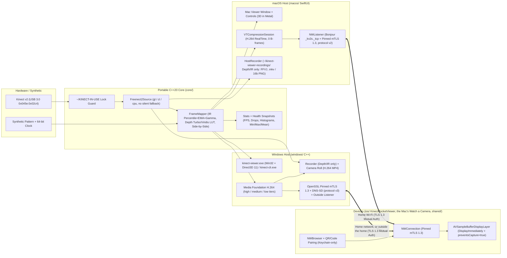

# Kinect v2 Live Viewer — System Design

How the repository fits together. The wire protocol is in [`protocol-changes.md`](protocol-changes.md) (v1 and v2) and [`protocol-v3-pet-camera.md`](protocol-v3-pet-camera.md) (v3), the Windows pet camera in [`pet-camera.md`](pet-camera.md), and the security model and its limits in [`SECURITY.md`](../SECURITY.md).

## 1. System Overview



| Part | Where | What it is |
|---|---|---|
| Core | `core/` | Portable C++20: the libfreenect2 and synthetic sources, the `KINECT-IN-USE` lock, the frame mapper and the stats, behind the C ABI in `core/include/kinect_core_c.h`. The Xcode targets compile it in; on Windows it is the `kinect_core` library (top-level `CMakeLists.txt`). |
| macOS host | `macos/` | `KinectViewer.app`: the viewer, inspection tools, the 3D point cloud (Metal), body pose from Apple's Vision, the second display, depth/IR recordings and their player, and the stream server for one paired iPhone. Its **Watch a Camera** mode is a device for a Windows pet camera. `macos/CLI` is `kinect-cli`. |
| Windows host | `windows/` | `kinect-viewer.exe` and `kinect-cli.exe`: the same viewer, inspection, 3D, second-display and depth/IR recording features, the stream server for many paired devices, and the pet camera (roles, privacy mode, sharing, the camera roll, viewing from outside the home). See [`windows-setup.md`](windows-setup.md). |
| iPhone app | `ios/` | Kinect Viewer on the home screen (the `KinectPocketViewer` target): watches either host live, controls it where the host allows, and browses and plays a Windows camera roll. It stores nothing but its Keychain pairing state. |
| Shared Swift | `shared/` | The wire protocol, pairing payloads and proofs, the certificate identity, and the stream client (`PocketStreamClientCore`) and display bridge that the iPhone app and the Mac's Watch a Camera mode share. |

---

## 2. Hard-Requirement Enforcement Matrix

| Rule | Architectural Enforcement |
|---|---|
| **1. Phone stores nothing** | `URLCache(memoryCapacity: 0, diskCapacity: 0, diskPath: nil)` on launch; zero `URLSession`/`FileManager` writes; `UIFileSharingEnabled = false`; Keychain-only pairing identity (`WhenUnlockedThisDeviceOnly`); `AVSampleBufferDisplayLayer.preventsCapture = true` blocks screenshots/screen-recordings at OS compositor; `flush(removingDisplayedImage: true)` and a hidden camera-roll grid on `willResignActive` and backgrounding keep frames out of SpringBoard's app-switcher snapshots. |
| **2. Recordings never leave host** | Both recorders write 16-bit depth and IR only and refuse every mode that carries colour ("Colour is live only"). Written exclusively to `~/kinect-viewer-recordings/` (Windows: `%USERPROFILE%\kinect-viewer-recordings\`, owner-only DACL, not content-indexed, OneDrive refused) inside `<timestamp>_<mode>.nosync/` directories; root folder carries `.nosync`, `.metadata_never_index`, and on the Mac the `tmutil addexclusion` sticky attribute. The wire protocol has **no** file transfer. Since v2 a paired phone can ask the host to start or stop a depth/IR recording, which is written on the host only; since v3 the Windows pet camera's clips can be listed and streamed for playback, never downloaded (2–4 below). |
| **3. No third-party servers** | Zero HTTP/HTTPS client calls, zero analytics SDKs, zero STUN/TURN/cloud servers. Discovery uses local mDNS (`_kv2s._tcp.local.`) only. Since v3 the Windows host can also listen for paired devices outside the home: off by default, turned on at the PC only, through a port mapping on the home router and never a third-party server (`protocol-v3-pet-camera.md` §8). |
| **4. Only paired devices can watch** | Each paired device's client X.509 SHA-256 fingerprint is stored on the host (one device before v3; since v3 several, each an owner or a viewer). Live port requires TLS 1.3 client cert (`sec_protocol_options_set_peer_authentication_required(..., true)`) and validates exact SHA-256 leaf match inside `sec_protocol_options_set_verify_block` *before* TLS handshake completes (Windows: OpenSSL's `SSL_VERIFY_FAIL_IF_NO_PEER_CERT` and a certificate verify callback, compared in constant time). Bonjour is completely off when unpaired unless pairing modal is open; when active, advertises only an opaque 12-hex-char ID with empty TXT record. |
| **2–4. The pet camera's exception** | For the Windows pet camera only, colour clips recorded on that PC (the camera roll) may be played to its paired devices; see [`pet-camera.md`](pet-camera.md) §1. The rules above are otherwise unchanged. |
| **5. Real frames are never inspected in development** | Real-camera tests run through `kinect-cli` / telemetry counters outputting strictly numbers (`fps`, `frames`, `drops`, `dt_ms`, `min`, `max`, `mean`, `saturated_px`, `invalid_px`, 16-bin integer histograms). Any UI screenshot verification runs exclusively with `--synthetic`. |
| **6. Driver is a thin dependency** | Links dynamically against an installed libfreenect2 (`<prefix>/lib/libfreenect2.dylib`; Windows: `freenect2.dll`, copied next to the programs) using its public headers (`<prefix>/include/libfreenect2/`) only. Zero driver patches. |
| **7. Local files only** | Recordings live in `~/kinect-viewer-recordings` and the device lock at `~/KINECT-IN-USE` (Windows: under `%USERPROFILE%`, with the host state in `kinect-viewer\.host-state\` and the camera roll in its own folder). Nothing is uploaded anywhere. |

---

## 3. Portable C++20 Core (`core/`) & C ABI (`kinect_core_c.h`)

### 3.1 Source & Pipeline Handling (Zero Silent Fallback)
- `kv_pipeline_t`:
  - `KV_PIPELINE_OPENGL` -> `new libfreenect2::OpenGLPacketPipeline(nullptr, false)`
  - `KV_PIPELINE_OPENCL` -> `new libfreenect2::OpenCLPacketPipeline(-1)`
  - `KV_PIPELINE_CPU` -> `new libfreenect2::CpuPacketPipeline()`
- Note on macOS `OpenGLPacketPipeline`: `libfreenect2`'s `OpenGLPacketPipeline` creates a GLFW hidden window/context internally, which on macOS **must** be constructed and driven with main-thread awareness or opened cleanly without conflicting with AppKit; if `openDevice(serial, pipeline)` returns `nullptr` for the requested pipeline, `core` immediately sets a descriptive error string (`"Failed to open Kinect v2 with OpenCL pipeline (no fallback performed)."`) and **never** falls back to CPU or OpenGL silently.
- Stream activation optimization:
  - When viewing **IR Only** or **Depth Only**, `startStreams(false, true)` is used (or `startStreams(true, true)` when Colour or Side-by-Side involving Colour is selected) so low-light 15 fps RGB auto-exposure never throttles pure IR/Depth 30 fps viewing, while independent non-blocking `FrameListener` callbacks (`onNewFrame`) decouple RGB (15–30 fps) from IR+Depth (30 fps) even when all three streams run simultaneously!
  - **Crucial insight**: In Protonect, `SyncMultiFrameListener(Color | Ir | Depth)` blocks until *all* requested types arrive, dragging 30 fps IR/Depth down to 15 fps when Colour drops to 15 fps in low light! By using our own custom `libfreenect2::FrameListener` subclass with separate atomic/mutex-guarded latest-frame slots for `Ir`, `Depth`, and `Color`, IR and Depth stay at **full 30 fps** even in Side-by-Side mode when Colour is running at 15 fps in low light!

### 3.2 Custom Quiet Logger
- Subclasses `libfreenect2::Logger` and installs via `libfreenect2::setGlobalLogger(...)`.
- Suppresses the two known benign messages (`"packets were lost"` on initial startup and `"LIBUSB_ERROR_NO_DEVICE"` / `"failed to release interface"` on teardown) into a separate `benign_driver_notices` counter while forwarding genuine warnings/errors to host diagnostics.

### 3.3 Tone-Mapping & Colormap Pipeline (`FrameMapper`)
1. **IR (`512×424` float `[0..65535]`)**:
   - Single pass computes `min`, `max`, `mean`, `saturated_count` (`v >= 65535.0f`), 16-bin telemetry histogram, and a 1024-bin auto-scale histogram over `(0, 65535)`.
   - Extracts $P_{\text{low}}$ (default 1.0%) and $P_{\text{high}}$ (default 99.5%), updates smoothed bounds $B_t, W_t$ with configurable EMA $\alpha$ (default `0.12`, or `1.0` if smoothing disabled, or manual `[min, max]` if auto-scale disabled), enforces $W_t - B_t \ge 256.0$, and applies a 1025-entry gamma LUT (default $\gamma = 0.45$) to emit `BGRA8`.
2. **Depth (`512×424` float mm)**:
   - Gates `!std::isfinite(d) || d <= 0.0f`, and a co-registered saturated IR pixel (`IR >= 65535`), -> `(0, 0, 0, 255)` black and increments `invalid_count`; depth outside the cut-off (`cutoff_near_mm..cutoff_far_mm`, when on) is black too.
   - Normalizes valid `d` over `[depth_min_mm, depth_max_mm]` (default `500..4500 mm`, user-adjustable `300..8000 mm`) as `t = clamp((d - min_mm) / (max_mm - min_mm), 0, 1)`, indexing `1.0 - t` (`depth_invert`, on by default, so closer objects appear warm/bright in Turbo/Inferno/Viridis and farther objects cool/darker) into exact 256-entry sRGB LUTs (**Turbo**, **Viridis**, **Inferno**, **Grayscale**).
3. **Colour (`1920×1080` `BGRX`)**:
   - Converts/copies `BGRX` with alpha forced to `0xFF` (`BGRA8`), exposing `Auto` (with exposure compensation `[-2.0, +2.0]`), `Semi-Auto Flicker-Free` (`pseudo_exposure_ms` `[1.0, 66.0]`), and `Manual` (`integration_time_ms` `[1.0, 66.0]`, `analog_gain` `[1.0, 4.0]`).
4. **Side-by-Side**:
   - Supports **IR + Depth** (`1024×424` native pixel-for-pixel) and **Colour + Depth** / **Colour + IR** (`1280×424` aspect-preserving composition: `754×424` 16:9 scaled Colour, a `14 px` divider and `512×424` Depth/IR, an even width for hardware H.264).
5. **3D Point Cloud** (`KV_MODE_POINT_CLOUD_3D`) and the **Depth/Colour Blend**:
   - The core supplies the depth, the IR camera's intrinsics and libfreenect2's registration; each host renders the cloud on its GPU (Metal on the Mac, Direct3D 11 on Windows) at `960×720`, and only that picture is encoded. The blend fades the depth colours over the registered colour, live only.

---

## 4. Network Wire Protocol & Pairing (`shared/WireProtocol.swift`, `windows/host/wire_protocol.{hpp,cpp}`)

All frames over the TLS 1.3 TCP connection (`TCP_NODELAY = 1`) use a compact big-endian header:

```
+----------------+----------------+----------------------------------+
| magic (2B)     | msg_type (1B)  | flags (1B)                       |
| 'K' 'V' (0x4B56)|                |                                  |
+----------------+----------------+----------------------------------+
| payload_length (4B uint32 BE, max 4 MiB)                           |
+--------------------------------------------------------------------+
| payload (payload_length bytes)                                     |
+--------------------------------------------------------------------+
```

- **Transport:** TLS 1.3 only. Both sides present self-signed ECDSA P-256 certificates and pin each other's SHA-256 leaf hash; no certificate authority is trusted.
- **Caps:** host → device frames are capped at 4 MiB. The Windows host closes a device → host frame over 64 KiB at its header; the macOS host reads up to 4 MiB (`SECURITY.md`, Known limitations).
- **Payloads** are compact JSON, except video: `0x03` is a 29-byte binary header (`streamEpoch`, `frameSeq`, `hostCaptureNs`, `hostEncodeDoneNs`, `flags`: bit 0 keyframe, bit 1 clock overlay) followed by AVCC NAL units. Both hosts send H.264; `codecRaw` 1 (HEVC) is defined but never sent.
- **Versions.** Each is additive. A connection starts at v1, and the device's ping raises it; v1 and v2 phones keep working against either host. The macOS host speaks up to v2; the Windows host, the iPhone app and the Mac's Watch a Camera mode speak v3.

| Version | Type bytes | Adds |
|---|---|---|
| v1 | `0x01`–`0x06` | hello, stream config, video, ping, pong, mode select |
| v2 | `0x07`–`0x0A` | host state, remote control, 3D orbit, sensor power ([`protocol-changes.md`](protocol-changes.md)) |
| v3 | `0x0B`–`0x0F`, `0x12`–`0x19` | pet-camera state and commands, results, notices, the camera roll and its playback ([`protocol-v3-pet-camera.md`](protocol-v3-pet-camera.md)) |

No message carries a depth/IR recording, and camera-roll clips are only streamed for playback, never downloaded.

### Pairing Handshake (Ephemeral Pairing Listener Only)
- A separate `_kv2p._tcp` listener runs **only** while a pairing window is open at the host (120 seconds, one attempt), and closes on success, failure, cancel, or timeout.
- `0x10` (pair request): the method (`0` QR token, `1` 8-digit short code, or `2` a one-time invite, which only the Windows host's outside listener takes), the client certificate and its HMAC proof. `0x11` (pair response): accepted or not, the service id, the stream port, the host's proof, and in v3 the device's role.
- Both sides derive `pair_key = HKDF-SHA256(ikm = secret, salt = SHA256(server_cert_der) || SHA256(client_cert_der), info = "kv2-pair-v1")`.
- Once verified, the host pins the device's certificate hash (one device on the macOS host; up to 16 on the Windows host, each an owner or a viewer) and the device keeps `(serviceId, pinned host certificate hash)` in its Keychain. The host then advertises `<12-hex serviceId>._kv2s._tcp.local` with an empty TXT record, and nothing while no device is paired.
