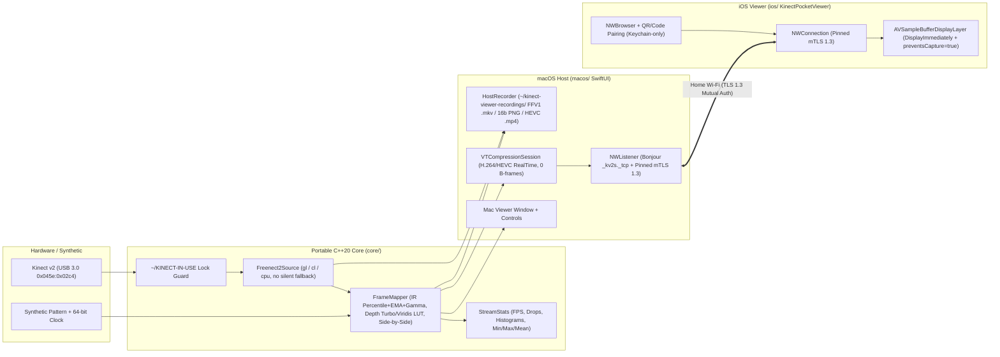

# Kinect v2 Live Viewer — System Design

## 1. System Overview



---

## 2. Hard-Requirement Enforcement Matrix

| Rule | Architectural Enforcement |
|---|---|
| **1. Phone stores nothing** | `URLCache(memoryCapacity: 0, diskCapacity: 0, diskPath: nil)` on launch; zero `URLSession`/`FileManager` writes; `UIFileSharingEnabled = false`; Keychain-only pairing identity (`WhenUnlockedThisDeviceOnly`); `AVSampleBufferDisplayLayer.preventsCapture = true` blocks screenshots/screen-recordings at OS compositor; `flushAndRemoveImage()` + black curtain on `willResignActive` prevents SpringBoard app-switcher disk snapshots. |
| **2. Recordings never leave host** | Written exclusively to `~/kinect-viewer-recordings/` inside `<timestamp>_<mode>.nosync/` directories; root folder carries `.nosync`, `.metadata_never_index`, and `tmutil addexclusion` sticky attribute. The wire protocol has **no** file transfer. Since v2 a paired phone can ask the host to start or stop a depth/IR recording, which is written on the host only; since v3 the Windows pet camera's clips can be listed and streamed for playback, never downloaded (2–4 below). |
| **3. No third-party servers** | Zero HTTP/HTTPS client calls, zero analytics SDKs, zero STUN/TURN/cloud servers. Discovery uses local mDNS (`_kv2s._tcp.local.`) only. Since v3 the Windows host can also listen for paired devices outside the home: off by default, turned on at the PC only, through a port mapping on the home router and never a third-party server (`protocol-v3-pet-camera.md` §8). |
| **4. Only paired devices can watch** | Each paired device's client X.509 SHA-256 fingerprint is stored on the host (one device before v3; since v3 several, each an owner or a viewer). Live port requires TLS 1.3 client cert (`sec_protocol_options_set_peer_authentication_required(..., true)`) and validates exact SHA-256 leaf match inside `sec_protocol_options_set_verify_block` *before* TLS handshake completes. Bonjour is completely off when unpaired unless pairing modal is open; when active, advertises only an opaque 12-hex-char ID with empty TXT record. |
| **2–4. The pet camera's exception** | For the Windows pet camera only, colour clips recorded on that PC (the camera roll) may be played to its paired devices, as the owner decided; see [`pet-camera.md`](pet-camera.md) §1. The rules above are otherwise unchanged. |
| **5. Real frames are never inspected in development** | Real-camera tests run through `kinect-cli` / telemetry counters outputting strictly numbers (`fps`, `frames`, `drops`, `dt_ms`, `min`, `max`, `mean`, `saturated_px`, `invalid_px`, 16-bin integer histograms). Any UI screenshot verification runs exclusively with `--synthetic`. |
| **6. Driver is a thin dependency** | Links dynamically against an installed libfreenect2 (`<prefix>/lib/libfreenect2.dylib`) using its public headers (`<prefix>/include/libfreenect2/`) only. Zero driver patches. |
| **7. Local files only** | Recordings live in `~/kinect-viewer-recordings` and the device lock at `~/KINECT-IN-USE`. Nothing is uploaded anywhere. |

---

## 3. Portable C++20 Core (`core/`) & C ABI (`kinect_core_c.h`)

### 3.1 Source & Pipeline Handling (Zero Silent Fallback)
- `kv_pipeline_t`:
  - `KV_PIPELINE_OPENGL` -> `new libfreenect2::OpenGLPacketPipeline(nullptr, false)`
  - `KV_PIPELINE_OPENCL` -> `new libfreenect2::OpenCLPacketPipeline(-1)`
  - `KV_PIPELINE_CPU` -> `new libfreenect2::CpuPacketPipeline()`
- Note on macOS `OpenGLPacketPipeline`: `libfreenect2`'s `OpenGLPacketPipeline` creates a GLFW hidden window/context internally, which on macOS **must** be constructed and driven with main-thread awareness or opened cleanly without conflicting with AppKit; if `openDevice(serial, pipeline)` returns `nullptr` for the requested pipeline, `core` immediately sets a descriptive error string (`"OpenCL pipeline failed to initialize..."`) and **never** falls back to CPU or OpenGL silently.
- Stream activation optimization:
  - When viewing **IR Only** or **Depth Only**, `startStreams(false, true)` is used (or `startStreams(true, true)` when Colour or Side-by-Side involving Colour is selected) so low-light 15 fps RGB auto-exposure never throttles pure IR/Depth 30 fps viewing, while independent non-blocking `FrameListener` callbacks (`onNewFrame`) decouple RGB (15–30 fps) from IR+Depth (30 fps) even when all three streams run simultaneously!
  - **Crucial insight**: In Protonect, `SyncMultiFrameListener(Color | Ir | Depth)` blocks until *all* requested types arrive, dragging 30 fps IR/Depth down to 15 fps when Colour drops to 15 fps in low light! By using our own custom `libfreenect2::FrameListener` subclass with separate atomic/mutex-guarded latest-frame slots for `Ir`, `Depth`, and `Color`, IR and Depth stay at **full 30 fps** even in Side-by-Side mode when Colour is running at 15 fps in low light!

### 3.2 Custom Quiet Logger
- Subclasses `libfreenect2::Logger` and installs via `libfreenect2::setGlobalLogger(...)`.
- Suppresses the two known benign messages (`"packets were lost"` on initial startup and `"LIBUSB_ERROR_NO_DEVICE"` / `"failed to release interface"` on teardown) into a separate `benign_notice_count` counter while forwarding genuine warnings/errors to host diagnostics.

### 3.3 Tone-Mapping & Colormap Pipeline (`FrameMapper`)
1. **IR (`512×424` float `[0..65535]`)**:
   - Single pass computes `min`, `max`, `mean`, `saturated_count` (`v >= 65535.0f`), 16-bin telemetry histogram, and a 1024-bin auto-scale histogram over `(0, 65535)`.
   - Extracts $P_{\text{low}}$ (default 1.0%) and $P_{\text{high}}$ (default 99.5%), updates smoothed bounds $B_t, W_t$ with configurable EMA $\alpha$ (default `0.12`, or `1.0` if smoothing disabled, or manual `[min, max]` if auto-scale disabled), enforces $W_t - B_t \ge 256.0$, and applies a 1024-entry gamma LUT (default $\gamma = 0.45$) to emit `BGRA8`.
2. **Depth (`512×424` float mm)**:
   - Gates `!(d > 0.0f) || !std::isfinite(d)` -> `(0, 0, 0, 255)` black and increments `invalid_count`.
   - Normalizes valid `d` over `[depth_min_mm, depth_max_mm]` (default `500..4500 mm`, user-adjustable `300..8000 mm`) as `t = clamp((d - min_mm) / (max_mm - min_mm), 0, 1)`, indexing `1.0 - t` (so closer objects appear warm/bright in Turbo/Inferno/Viridis and farther objects cool/darker, with optional invert toggle) into exact 256-entry sRGB LUTs (**Turbo**, **Viridis**, **Inferno**, **Grayscale**).
3. **Colour (`1920×1080` `BGRX`)**:
   - Converts/copies `BGRX` with alpha forced to `0xFF` (`BGRA8`), exposing `Auto` (with exposure compensation `[-2.0, +2.0]`), `Semi-Auto Flicker-Free` (`pseudo_exposure_ms` `[1.0, 66.0]`), and `Manual` (`integration_time_ms` `[1.0, 66.0]`, `analog_gain` `[1.0, 4.0]`).
4. **Side-by-Side**:
   - Supports **IR + Depth** (`1024×424` native pixel-for-pixel) and **Colour + Depth** / **Colour + IR** (`1280×424` or `1536×424` aspect-preserving composition: `754×424` 16:9 scaled Colour alongside `512×424` Depth/IR = `1266×424` padded to even `1280×424` for hardware H.264/HEVC!).

---

## 4. Network Wire Protocol & Security (`shared/`)

All frames over the TLS 1.3 TCP connection (`TCP_NODELAY = 1`) use a compact big-endian header:

```
+----------------+----------------+----------------------------------+
| magic (2B)     | msg_type (1B)  | flags (1B)                       |
| 'K' 'V' (0x4B56)|                |                                  |
+----------------+----------------+----------------------------------+
| payload_length (4B uint32 BE, max 4 MiB)                           |
+--------------------------------------------------------------------+
| payload (payload_length bytes)                                     |
+--------------------------------------------------------------------+
```

### Message Types
- `0x01 HELLO_SERVER`: `{ protocol_version: 1, current_mode, allow_phone_mode_switch, width, height, codec (0=H264, 1=HEVC), fps_hint }`
- `0x02 STREAM_CONFIG`: `{ stream_epoch: uint32, codec: uint8, width: uint16, height: uint16, mode: uint8, param_sets_blob (SPS/PPS or VPS/SPS/PPS) }`
- `0x03 VIDEO_AU`: `{ stream_epoch: uint32, frame_seq: uint64, host_capture_ns: uint64, host_encode_ns: uint64, flags: uint8 (bit0=keyframe, bit1=synthetic_clock), avcc_hvcc_nalus... }`
- `0x04 PING`: `{ client_send_ns: uint64, last_decoded_seq: uint64, last_display_latency_us: uint32, barcode_latency_us: uint32 }`
- `0x05 PONG`: `{ client_send_ns: uint64, server_recv_ns: uint64, server_send_ns: uint64 }`
- `0x06 SELECT_MODE_REQ`: `{ requested_mode: uint8 }` (honored only if `allow_phone_mode_switch == true`; **no** recording or file messages exist in the protocol).

### Pairing Handshake (Ephemeral Pairing Listener Only)
- Separate `NWListener` started **only** while the Mac's 120-second "Pair iPhone…" sheet is open; shut down immediately upon success, failure, cancel, or timeout.
- Uses TLS 1.3 where both sides present their self-signed ECDSA P-256 `SecIdentity`.
- `0x10 PAIR_REQ`: `{ method: (0=QR, 1=ShortCode), client_cert_der, client_hmac32 }`
- `0x11 PAIR_RESP`: `{ status: (0=OK, 1=REJECT), bonjour_service_id, stream_port: uint16, server_hmac32 }`
- Both sides derive `pair_key = HKDF-SHA256(ikm = secret, salt = SHA256(server_cert_der) || SHA256(client_cert_der), info = "kv2-pair-v1")`.
- Once verified, the Mac persists `pinned_client_cert_sha256` and closes the pairing listener; the iPhone persists `(bonjour_service_id, pinned_server_cert_sha256)` in iOS Keychain and connects to the main mTLS 1.3 stream listener.

---

## 5. Phased Implementation & Commit Plan

1. **Phase 1 — Mac Viewer (IR Mode Only) + Portable Core**:
   - Build `core/` (CMake + Xcode target), `~/KINECT-IN-USE` guard, `SyntheticFrameSource`, `Freenect2FrameSource`, `FrameMapper` (IR percentile + EMA + gamma), `KinectHostApp` (IR live view, FPS/drop counters, IR controls), and `kinect-cli`.
   - Verify synthetic test + 60-second real Kinect v2 run at 30 fps with non-growing latency. Commit Phase 1.
2. **Phase 2 — All Modes & Pipeline Selector**:
   - Add Depth false-colour (Turbo/Viridis/Inferno/Grayscale + min/max mm sliders), Colour (1080p + Auto/Semi-Auto/Manual exposure & gain), Side-by-Side (IR+Depth, Colour+Depth, Colour+IR), and explicit pipeline selector (`gl`, `cl`, `cpu`) with zero silent fallback.
   - Verify all modes and all three pipelines (`gl`, `cl`, `cpu`) numerically. Commit Phase 2.
3. **Phase 3 — Live Encrypted Streaming to iPhone**:
   - Implement `CryptoIdentity`, `PairingPayload`, `VideoToolboxEncoder`, `HostStreamServer`, and the full iOS `KinectPocketViewer` app (`NWBrowser`, QR + short-code pairing, pinned mTLS 1.3 `NWConnection`, `AVSampleBufferDisplayLayer` with `DisplayImmediately` + `preventsCapture = true`, zero-disk enforcement).
   - Measure end-to-end latency using the synthetic clock + 64-bit barcode pattern (target < 150 ms) and verify signed `generic/platform=iOS` device build + live Simulator run. Commit Phase 3.
4. **Phase 4 — Host-Only Recording**:
   - Implement `HostRecorder` writing exclusively to `~/kinect-viewer-recordings/` with `.nosync`, `tmutil addexclusion`, and `.metadata_never_index`.
   - Support lossless FFV1 `.mkv` / 16-bit PNG for IR & Depth and hardware HEVC `.mp4` for Colour & Side-by-Side, displaying live MB/min. Verify exclusions, lossless bit-exactness on synthetic data, and real-stream MB/min. Commit Phase 4.
5. **Phase 5 — Hardening**:
   - Implement and test auto-reconnect, USB unplug/replug recovery (`IOKit` USB notifications + device watchdog), macOS sleep/wake (`NSWorkspace.willSleepNotification` / `didWakeNotification`), two-phone enforcement (second phone rejected), and unpaired-device TLS handshake rejection test (confirming zero bytes leaked). Commit Phase 5.
6. **Phase 6 — Windows Host Plan & Final Handover Docs**:
   - Write the Windows porting plan, `docs/test-results.md` (with every measured number), and `README.md`. Commit Phase 6. (The Windows host as built: `docs/windows-setup.md`.)
